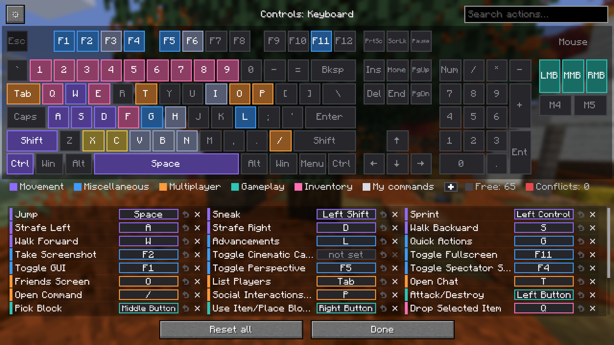
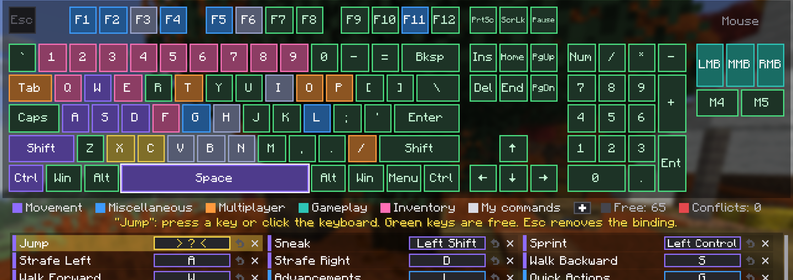
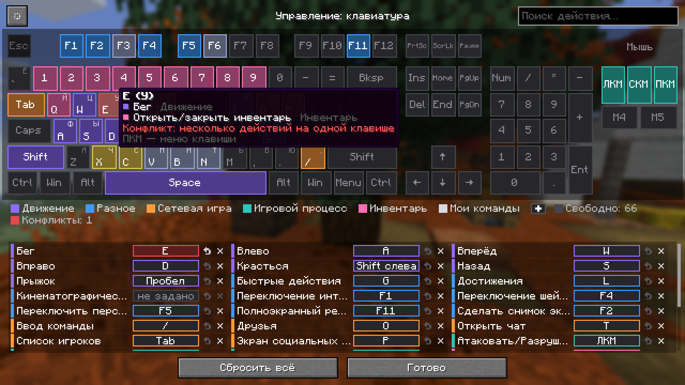
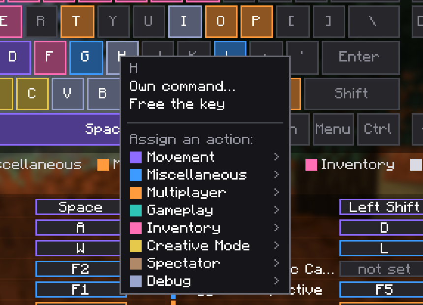
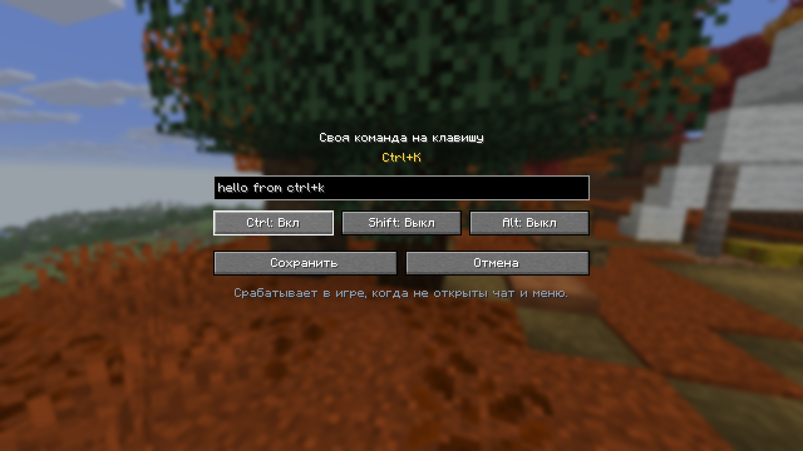
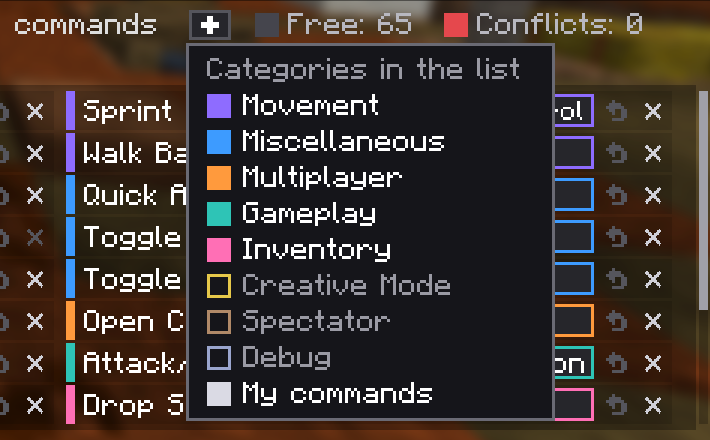
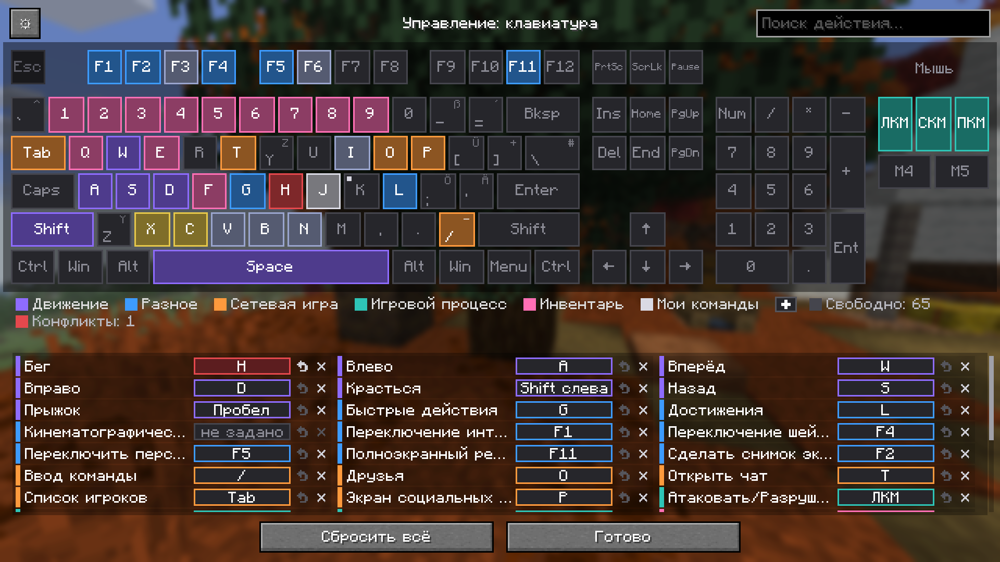

# BeezzKeys

A Minecraft mod that turns the Key Binds screen into a drawn keyboard: you see at a glance which keys are taken, which are free and where two actions clash. Client-side. Fabric: Minecraft 26.1 – 26.3, 1.21.11, 1.21.1, 1.20.1. NeoForge: 1.21.1. Forge: 1.20.1.

Мод для Minecraft, который превращает «Назначение клавиш» в нарисованную клавиатуру: сразу видно, какие клавиши заняты, какие свободны и где конфликты. Только клиент. Fabric: Minecraft 26.1 – 26.3, 1.21.11, 1.21.1, 1.20.1. NeoForge: 1.21.1. Forge: 1.20.1. [Описание на русском ниже](#по-русски).



## What it does

- **Used, free, clashing.** A used key takes the colour of its category, a free key stays grey, a key with two actions is red. Keys of other mods are there too, each mod's category gets its own colour.
- **Binding.** Click an action in the list, then press a key or click it on the drawing; free keys light up green while you choose. Or drag the action onto a key.
- **Right-click a key** for its menu: put any action of any category on it, free it, or give it your own command.
- **Your own commands.** A key can send a command (`/home`) or a chat line. Commands also take Ctrl, Shift and Alt, so `Ctrl+H` and `H` are different binds. Hold a modifier on the screen to see what is taken with it.
- **English letters first.** Keys are labelled with English letters; the letter of the game's language sits small in the corner (Й on Q for Russian, Z on Y for German). Built-in tables: Russian, Ukrainian, Belarusian, German, French, Spanish, Portuguese, Turkish; other languages use the system layout.
- **Categories.** The "+" under the keyboard chooses which categories the list shows. The keyboard itself always shows everything.
- **Gear menu.** Named sets of key binds (save, load, share as a file), a numpad switch, undo (Ctrl+Z) and the plain Minecraft list.

| | |
|---|---|
|  |  |
|  |  |
|  |  |

## Install

1. Install the loader for your game version: [Fabric Loader](https://fabricmc.net/use/) with [Fabric API](https://modrinth.com/mod/fabric-api), [NeoForge](https://neoforged.net/) or [Forge](https://files.minecraftforge.net/).
2. Take the jar for your game version and loader from [Releases](../../releases) and put it into the `mods` folder.

| Game | Fabric | NeoForge | Forge |
|---|---|---|---|
| 26.1 – 26.3 | yes | | |
| 1.21.11 | yes | | |
| 1.21 – 1.21.1 | yes | yes | |
| 1.20.1 | yes | | yes |
3. Open Options → Controls → Key Binds.

The mod is only needed on the client. It works on any server and in single player.

## Good to know

- Minecraft itself has no key combinations for its actions, so Ctrl / Shift / Alt work for your own commands only.
- A command on a plain key does not replace the game's action on the same key: both fire, and the keyboard shows it as a conflict. A command on a combination hides the key press from the game.
- Commands work from the keyboard, not from mouse buttons.
- Some servers forbid macros. One command per key press is usually fine, but check the rules of your server.
- Sets are files in `config/beezzkeys/presets`, your commands and choices are in `config/beezzkeys.json`.

## Build

JDK 25 is needed.

```bash
./gradlew build                                                              # 26.3
./gradlew jar -Pminecraft_version=26.2   -Pfabric_version=0.161.0+26.2       # 26.2
./gradlew jar -Pminecraft_version=26.1.2 -Pfabric_version=0.155.3+26.1.2     # 26.1
```

Other game versions and loaders are generated from the same code: see [ports/README.md](ports/README.md).

`./gradlew runClientGameTest` starts a real client, clicks through the screen and saves screenshots to `build/run/clientGameTest/screenshots`. What differs between game versions lives in `src/compat`.

## По-русски

**BeezzKeys** заменяет экран «Настройки → Управление → Назначение клавиш» нарисованной клавиатурой.

- **Занято, свободно, конфликт.** Занятая клавиша закрашена цветом категории, свободная серая, клавиша с двумя действиями красная. Клавиши других модов тоже видны, у категории каждого мода свой цвет.
- **Назначение.** Кликните действие в списке и нажмите клавишу или кликните по ней на схеме; свободные клавиши в этот момент подсвечены зелёным. Действие можно и перетащить на клавишу.
- **ПКМ по клавише** открывает её меню: повесить любое действие из любой категории, освободить клавишу или задать свою команду.
- **Свои команды.** Клавиша может отправлять команду (`/home`) или сообщение в чат. Команды работают и с Ctrl, Shift, Alt: `Ctrl+H` и `H` — разные бинды. Зажмите модификатор на экране, чтобы увидеть, что с ним занято.
- **Английские буквы.** На клавишах английские буквы, а буква языка игры стоит мелко в углу. Таблицы есть для русского, украинского, белорусского, немецкого, французского, испанского, португальского и турецкого; для остальных языков берётся раскладка системы.
- **Категории.** «+» под клавиатурой выбирает, какие категории показывать в списке. Сама клавиатура всегда показывает всё.
- **Шестерёнка.** Наборы раскладок (сохранить, загрузить, передать файлом), переключатель цифрового блока, отмена (Ctrl+Z) и обычный список Minecraft.

**Установка:** поставьте под свою версию игры Fabric Loader с Fabric API, NeoForge или Forge, скачайте jar под версию и загрузчик из [Releases](../../releases) и положите в папку `mods`. Мод нужен только на клиенте.

**Что стоит знать:** в самом Minecraft сочетаний клавиш для действий нет, поэтому Ctrl / Shift / Alt работают только для своих команд. Команда на обычной клавише не отменяет действие игры на ней — сработают оба. На некоторых серверах макросы запрещены: сверьтесь с правилами.

## License

MIT
